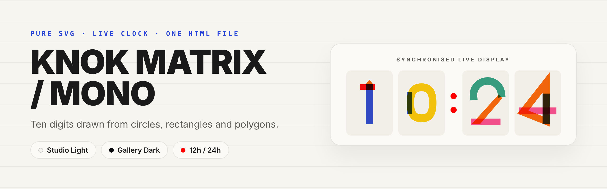
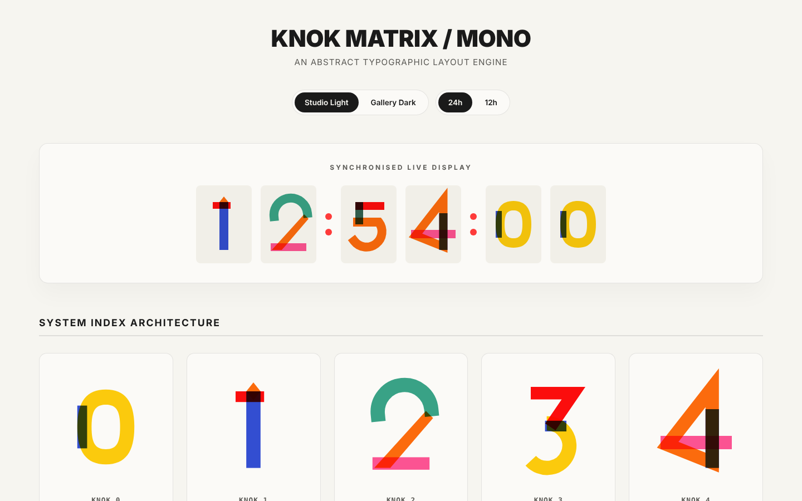
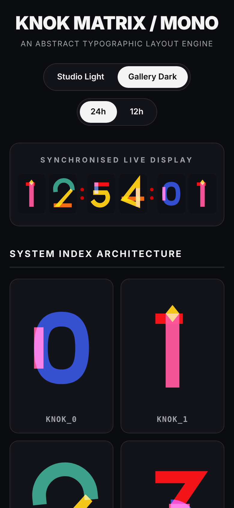
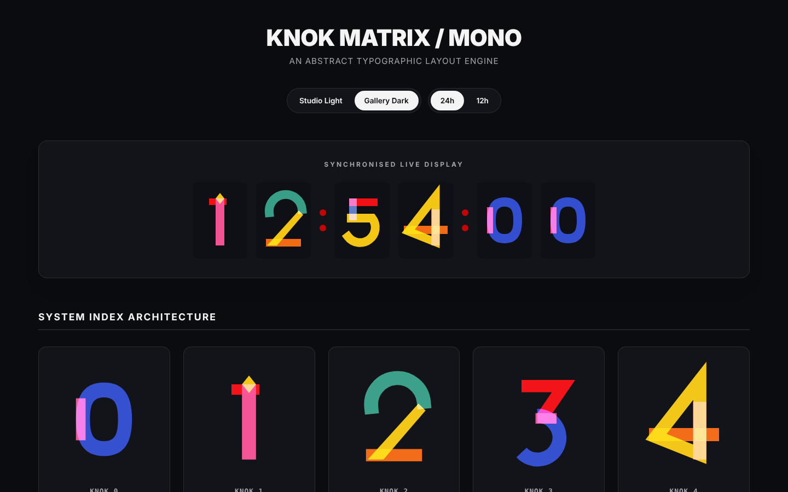

<p align="center">
  <a href="https://shazmoghaddam.github.io/knok-matrix/">
    
  </a>
</p>

# KNOK Matrix / Mono

[](https://github.com/ShazMoghaddam/knok-matrix/actions/workflows/ci.yml)
[](LICENSE)
[](CHANGELOG.md)
[](https://shazmoghaddam.github.io/knok-matrix/)


Ten digits, each drawn by hand from SVG circles, rectangles and polygons. The same glyphs power a design index and a live clock, in one HTML file with no libraries.

**[Open the live demo →](https://shazmoghaddam.github.io/knok-matrix/)**

**Contents:** [Features](#features) · [Screenshots](#screenshots) · [How it works](#how-it-works) · [Colour palette](#colour-palette) · [Accessibility](#accessibility) · [Run it](#run-it) · [Layout](#layout)

## Features

- **Ten hand-made glyphs.** Every digit is a small composition of primitive shapes in a 500 × 700 grid. No fonts, no images, no canvas.
- **Live clock.** Ticks on the real second boundary, so it never drifts behind your system clock. Choose **24h** or **12h** (with AM/PM). Your choice is remembered.
- **Two themes.** *Studio Light* mixes colours like ink on paper. *Gallery Dark* mixes them like light from a projector. It follows your device's theme until you pick one.
- **Works everywhere.** Tested at 320 px phones up to wide desktops, with keyboard support and screen-reader text.
- **One file.** Open `index.html` in any modern browser. No build step.

## Screenshots

<table>
  <tr>
    <td width="66%"></td>
    <td width="34%" rowspan="2"></td>
  </tr>
  <tr>
    <td></td>
  </tr>
</table>

## How it works

### One glyph store, two views

All ten glyphs live in a single `<template id="digit-templates">`. The browser never renders a template, so it works as an inert asset store. On load, each glyph is cloned with `cloneNode(true)` into the design index and, as the time changes, into the clock. One definition per glyph, no duplication.

### Blend modes do the colour mixing

Every shape uses `mix-blend-mode: var(--blend-mode)`, and each theme sets that variable:

| Theme | Mode | Effect |
|---|---|---|
| **Studio Light** | `multiply` | Overlaps get darker, like ink on paper |
| **Gallery Dark** | `screen` | Overlaps get brighter, like light on a wall |

The geometry never changes. Only one CSS variable does.

### Knockouts

The rings in 0, 6, 8 and 9 are a filled shape with a smaller shape on top marked `class="knockout"`. A knockout is painted in the exact colour of the surface underneath:

```css
.digit-card       { --knockout: var(--surface); }
.clock-digit-box  { --knockout: var(--surface-sunk); }
.art-digit .knockout { fill: var(--knockout) !important; mix-blend-mode: normal !important; }
```

Each container sets its own `--knockout`, so a hole matches its card or clock box exactly, in both themes, with no JavaScript.

### A clock that only touches what changed

`drawSlot()` keeps the last value drawn in each of the six slots and only replaces an SVG when its digit changes. The hours slot can go 60 minutes without a single DOM update. The tick is scheduled for the start of each second, and it pauses while the tab is hidden, then resyncs the moment you come back.

### Themes without a flash

A few lines in `<head>` read your saved theme (or your device's) and set `data-theme` before the page paints, so dark mode never flashes white first.

## Colour palette

| Variable | Name | Hex |
|---|---|---|
| `--color-mint` | Mint | `#2FA084` |
| `--color-ultramarine` | Ultramarine | `#3852B4` |
| `--color-deepgreen` | Deep Green | `#285A48` |
| `--color-royalfall` | Royal Fall | `#2845D6` |
| `--color-amethyst` | Amethyst | `#B153D7` |
| `--color-purered` | Pure Red | `#FF0000` |
| `--color-cornflower` | Cornflower | `#5A7ACD` |
| `--color-vibrantyellow` | Vibrant Yellow | `#FFCC00` |
| `--color-slate` | Slate | `#7F8CAA` |
| `--color-safetyorange` | Safety Orange | `#FF6500` |
| `--color-hotpink` | Hot Pink | `#FF4B91` |

Each theme maps these to seven slot colours (`--c1` to `--c7`) in a different order, so the same shapes read differently in light and dark.

## Accessibility

- Each glyph has `role="img"` and a label. The clock's visual digits are hidden from screen readers, which get a plain text time instead.
- That time text updates once a minute and is **not** a live region, so a screen reader is never interrupted every second.
- Theme and clock-format buttons are real buttons with `aria-pressed`, and every control shows a clear focus ring.
- `prefers-reduced-motion` stops the pulsing dots and the card hover lift.
- Text meets WCAG AA contrast in both themes.

## Run it

Open `index.html` in a browser. That's it.

To run the tests or rebuild the images, you need Node 20 or later:

```bash
npm install
npx playwright install chromium
npm test                 # smoke tests at 320, 390, 768, 1024 and 1440 px
npm run build:assets     # banner, social preview and screenshots
```

## Layout

```
index.html            the whole project: markup, styles, glyphs and script
assets/
  banner.png          README banner
  social-preview.png  GitHub social preview (Settings > Social preview)
  screenshots/        README screenshots
  build.mjs           builds all of the above from index.html
scripts/serve.mjs     tiny static server used by the build and tests
tests/smoke.mjs       headless browser tests, run in CI
```

## Licence

[MIT](LICENSE)

---

Created by **Shaz Moghaddam** · London  
[Website](https://shazmoghaddam.github.io/) · [LinkedIn](https://www.linkedin.com/in/shazmoghaddam/)
